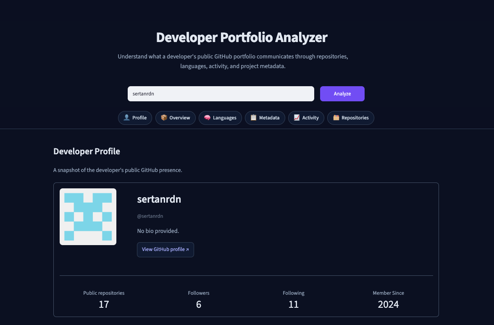
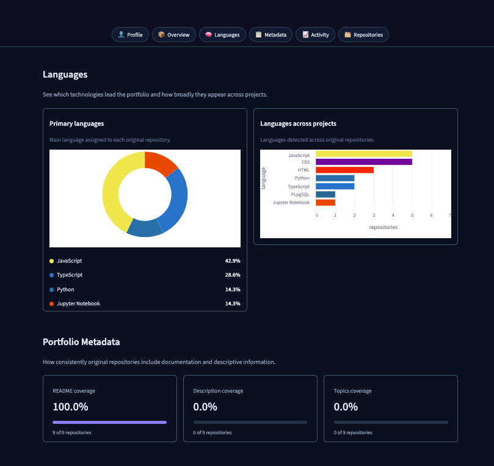
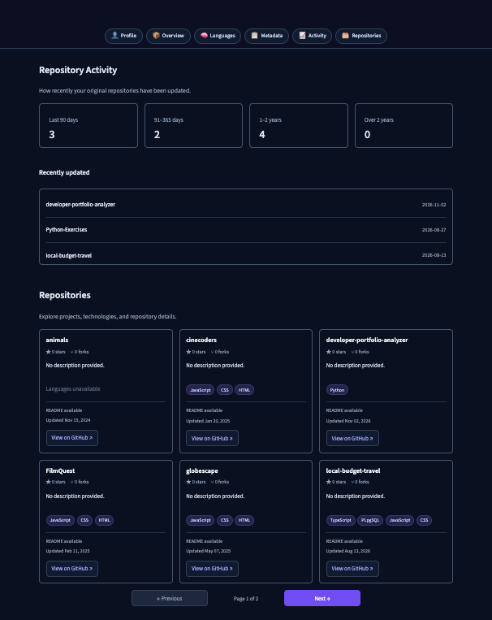

# Developer Portfolio Analyzer

A Python application that analyzes a developer's public GitHub portfolio and presents factual, descriptive insights through a **Streamlit dashboard** and a **command-line interface**.

Instead of assigning a developer "score", it reports what a public portfolio actually communicates: which technologies appear, how documented the projects are, and how recently they were updated.

I started this project as a Python CLI to learn how to work with the GitHub REST API and analyze repository data. As the analysis grew, I added a Streamlit dashboard to make the findings easier to explore. The project is still designed as a learning exercise: the focus is on understanding the implementation, not building a large application as quickly as possible.

<!-- Live demo: add the link here after deployment, for example:
**Live demo:** https://your-app-name.streamlit.app
-->

## Screenshots







## Why this project exists

This is a learning project for Python and backend development, built incrementally against a real-world API. It is intentionally small and readable. The focus is on working with an external API, handling failure properly, separating concerns, and testing without live network calls.

## What it shows

For any public GitHub username, the dashboard presents six sections:

| Section | What it describes |
|---|---|
| **Developer Profile** | Avatar, name, bio, location, company, follower and repository counts, member-since year |
| **Repository Overview** | Original, forked and archived repositories (forks are kept out of the analysis) |
| **Languages** | Primary-language share per original repository, plus which languages appear across repositories |
| **Portfolio Metadata** | README, description and topics coverage across original repositories |
| **Repository Activity** | How recently original repositories were updated, in four freshness periods, plus the three most recent |
| **Repositories** | Browsable cards with description, languages, topics, README status, stars, forks and last update |

A sticky navigation bar links to every section.

The same analysis is available in the terminal through `main.py`.

## Design principles

- **No arbitrary developer score.** The app reports observable facts only.
- **Missing is not the same as unknown.** If a request to GitHub fails, the result is shown as *unknown*, never as "no README" or "no languages". Coverage percentages are calculated from known results only, and the dashboard warns when results are partial.
- **Original repositories are the focus of analysis.** Forked repositories are shown separately in the overview, but excluded from repository-level analysis.
- **Clear separation of responsibilities.** Fetching, analysis and presentation live in separate modules.

## Tech stack

| Technology | Purpose |
|---|---|
| Python 3.11+ | Application logic and analysis |
| GitHub REST API | Public profile and repository data |
| `requests` | HTTP requests |
| `python-dotenv` | Loading the token from `.env` |
| Streamlit | Interactive dashboard |
| Altair | Language charts |
| `pytest` | Automated tests |

Python 3.11 or newer is required, because the code parses GitHub's `Z`-suffixed timestamps with `datetime.fromisoformat`.

## Getting started

### Prerequisites

- Python 3.11 or newer
- Git
- A GitHub personal access token. For reading public data, a token with no extra permissions is enough.

### 1. Clone the repository

```bash
git clone https://github.com/sertanrdn/developer-portfolio-analyzer.git
cd developer-portfolio-analyzer
```

### 2. Create a virtual environment

macOS or Linux:

```bash
python3 -m venv .venv
source .venv/bin/activate
```

Windows:

```powershell
python -m venv .venv
.venv\Scripts\activate
```

### 3. Install dependencies

```bash
python -m pip install -r requirements.txt
```

### 4. Add your GitHub token

Create a `.env` file in the project root:

```dotenv
GITHUB_TOKEN=your_github_token_here
```

Do not put quotes around the token. The `.env` file is ignored by Git. Never commit it or share your token.

## Usage

### Dashboard

```bash
streamlit run streamlit_app.py
```

Open the local URL that Streamlit prints, enter a GitHub username, and select **Analyze**.

### Command line

```bash
python main.py
```

Enter a username when prompted. The CLI prints the profile, repository summary, language statistics, metadata coverage, activity and README coverage. It exits with code 1 and a clear message if the token, username or GitHub request fails.

## How it works

```text
GitHub REST API
      │
      ▼
github_api.py      fetches data, handles errors and rate limits
      │
      ▼
analysis.py        pure functions, no network code
      │
      ▼
portfolio.py       analyze_portfolio(): runs fetch → process → analyze once
      │
      ├──► main.py           command-line output
      └──► streamlit_app.py  dashboard, using the modules in ui/
```

- `analyze_portfolio(username, github_token)` is the single place that sequences the steps. It returns one dictionary used by both the CLI and the dashboard. It catches no exceptions, so each entry point decides how to word errors.
- `fetch_user_profile` and `fetch_repositories` raise custom exceptions (`GitHubUserNotFoundError`, `GitHubAuthenticationError`, `GitHubRateLimitError`, `GitHubRequestError`), all subclasses of `GitHubError`. A failure on any repository page raises, so a partial list is never presented as complete.
- `fetch_readme_data` and `fetch_language_data` never raise. They return one entry per original repository with an `error` reason, and stop early after an authentication failure or rate limit.

### GitHub API usage

One analysis makes one profile request, a few repository-list requests (100 repositories per page), and two requests per original repository (README and languages). Requests are authenticated and use a 10-second timeout. Heavy use can reach GitHub's rate limit. The app shows a clear message when that happens.

## Project structure

```text
developer-portfolio-analyzer/
├── main.py                # command-line entry point
├── streamlit_app.py       # dashboard entry point
├── github_api.py          # GitHub API access and error handling
├── analysis.py            # data processing and statistics
├── portfolio.py           # analyze_portfolio(): one shared workflow
├── requirements.txt
├── .env.example
├── PROJECT_STATUS.md      # detailed development status and roadmap
├── .streamlit/
│   └── config.toml        # theme settings
├── ui/                    # one module per dashboard section
│   ├── profile.py
│   ├── overview.py
│   ├── languages.py
│   ├── metadata.py
│   ├── activity.py
│   ├── repositories.py
│   ├── navigation.py
│   └── styles.py
├── docs/
│   └── screenshots/
│       ├── dashboard-overview.png
│       ├── languages-metadata.png
│       └── activity-repositories.png
└── tests/
    ├── test_analysis.py
    ├── test_github_api.py
    └── test_portfolio.py
```

## Running the tests

```bash
python -m pytest
```

There are 44 tests covering the API layer (status codes, timeouts, pagination, partial results), the analysis functions, and the `analyze_portfolio` workflow. **All GitHub requests are mocked**, so the tests need no token and no network access. The CLI and the Streamlit pages have no automated tests; they were checked manually.

## Known limitations

- Python 3.11 or newer is required (see Tech stack).
- Original repositories without a `pushed_at` value are left out of the activity periods, so those counts can add up to fewer than the number of original repositories.
- Activity periods use whole days, so a push 90 days and 23 hours ago still counts as "last 90 days".
- The metadata cards show "X of N repositories" where N includes unknown results, while the percentage uses known results only.
- A repository card shows "Languages unavailable" both when the language request failed and when GitHub detected no languages in the repository.
- Streamlit's native charts and the username input keep their light styling on the dark theme.
- The sticky navigation uses the CSS `:has()` selector and was checked in Chrome only.

More detail is in [PROJECT_STATUS.md](PROJECT_STATUS.md).

## What I practiced

- Calling a real REST API with `requests`, including authentication, pagination, timeouts and rate limits
- Designing custom exceptions and deciding where errors should be handled
- Representing unknown data honestly instead of guessing
- Separating fetching, analysis and presentation
- Testing code that talks to the network by mocking it with `pytest` and `unittest.mock`
- Streamlit's execution model, session state and custom CSS
- Working with feature branches, pull requests and a written project status

## Author

[GitHub](https://github.com/sertanrdn) · [LinkedIn](https://www.linkedin.com/in/sertan-d-b6769087/)
